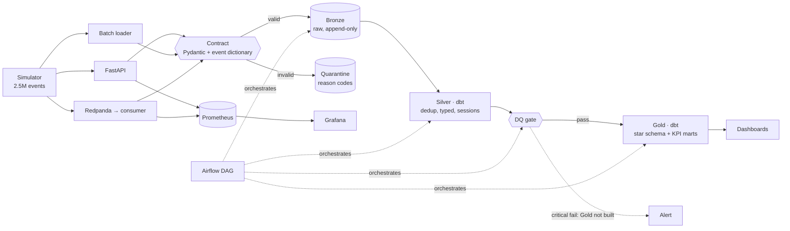
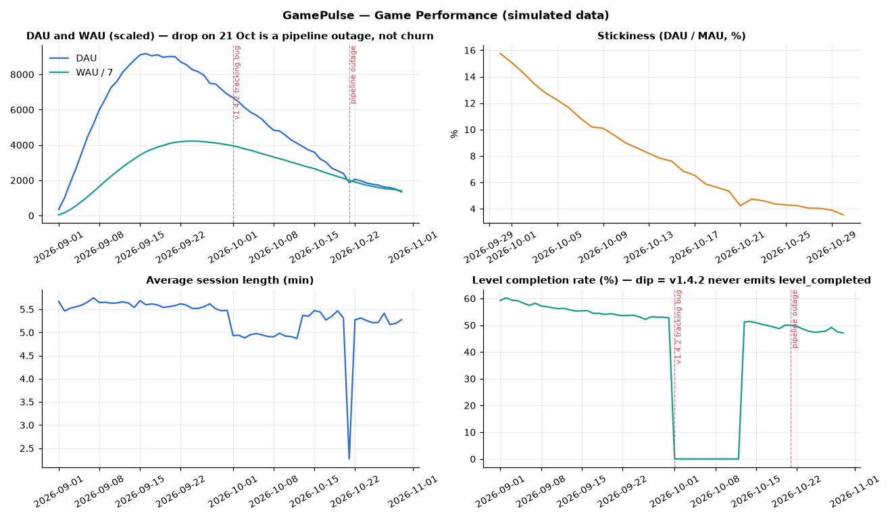
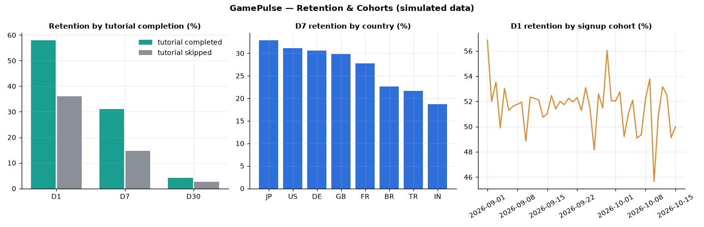
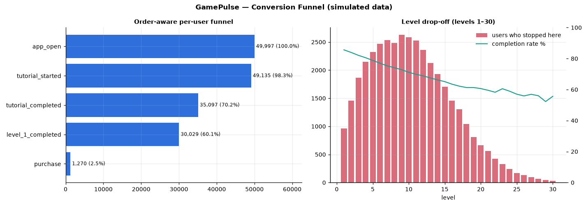
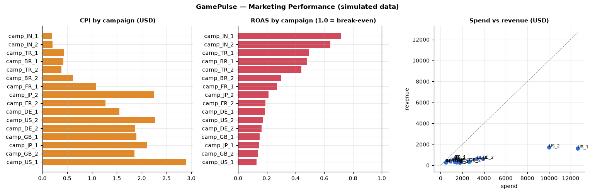
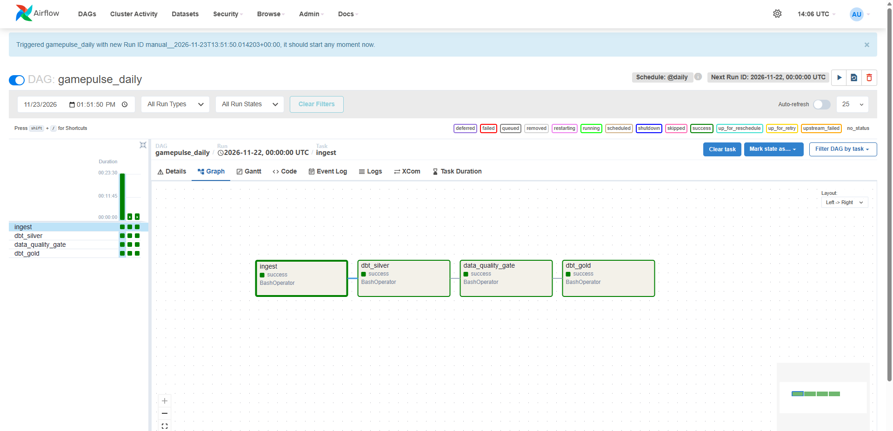
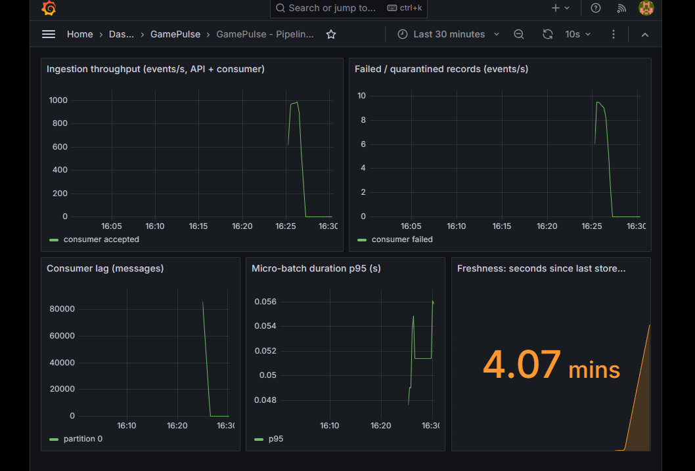

# GamePulse — Mobile Game Analytics & Data Platform

An end-to-end data platform for a mobile game: validated event ingestion (REST API, batch, Kafka-compatible stream) → **Bronze / Silver / Gold** layers modelled with **dbt** → analytics (DAU/MAU, retention cohorts, funnels, level drop-off, campaign ROAS) → **data-quality gate, anomaly detection and monitoring**. It runs locally for free (DuckDB) and on **BigQuery** with the same dbt models.

> ⚠️ **All data is synthetic.** Events and campaign spend come from a seeded Python simulator (50k players, ~2.5M events) that also injects known defects (duplicates, future timestamps, a tracking bug, an outage) so the quality checks can be proven. No real company or player data is used; the business findings illustrate the method, not real markets.



## Technologies — what, why, how
| Technology | Why it is here | How it is used |
|---|---|---|
| **Python** (pandas, NumPy, PyArrow) | Data generation and glue code | Seeded event simulator, Parquet I/O, DQ and anomaly modules |
| **Pydantic + YAML event dictionary** | Bad data must be stopped at the door | One YAML defines events and required fields; invalid events are quarantined with a reason code instead of being lost |
| **FastAPI** | Typed, fast ingestion endpoint | `/v1/events` with API key (constant-time compare), rate limit, body/batch limits, Prometheus `/metrics` |
| **DuckDB** | Free, zero-setup warehouse for dev/CI | Local Bronze store and the dbt target for tests |
| **BigQuery** | The warehouse the job market uses | Same dbt models run on a live project (Sandbox); partition by date, cluster by user/event configured |
| **dbt** | Versioned, tested SQL transformations and lineage | 17 models (staging → intermediate → marts), 27 tests, incremental upsert, cross-engine macros |
| **SQL (CTEs, window functions)** | The core analytics skill | `LAG` sessionization, cohort retention D1/D7/D30, rolling MAU, order-aware funnel, ROAS |
| **Redpanda (Kafka API)** | Streaming path next to batch | Producer → topic → consumer micro-batches; offsets committed after the write; replays are idempotent |
| **Airflow** | Scheduling, retries, dependencies | DAG `ingest → dbt_silver → data_quality_gate → dbt_gold`; the gate has no retries so bad data never reaches Gold |
| **Prometheus + Grafana** | You cannot trust a pipeline you cannot see | Throughput, quarantined records, consumer lag, batch p95, freshness |
| **Docker / Compose** | Reproducible environment | Non-root images, ports bound to `127.0.0.1`, no default passwords |
| **pytest, ruff, bandit, GitHub Actions, Dependabot** | Quality and supply-chain safety | 54 tests (80 % coverage) incl. dbt golden-fixture and incremental tests; lint + security scan in CI |
| **matplotlib** | Offline dashboards, no BI licence | Renders the four dashboards below from the Gold tables |

## Results (simulated data, 50,000 players)
| Metric | Value |
|---|---|
| Events received / accepted at ingestion / quarantined | 2,510,056 / 2,487,517 / 22,539 |
| Valid events in Silver (after dedup + future-timestamp removal) | 2,472,591 |
| Retention D1 / D7 / D30 | **51.7 % / 26.4 % / 3.7 %** |
| D7 retention: tutorial completed vs skipped | **31.1 % vs 14.7 %** |
| Funnel (per user, in order) | 49,997 → 49,135 → 35,097 → 30,029 → **1,270 purchasers** |
| Best / worst campaign ROAS | camp_IN_1 **0.72** (CPI $0.19) / camp_US_1 **0.13** (CPI $2.89) |
| Retention query: raw events → Silver → Gold | 140 ms → 50 ms → **2.4 ms** (BigQuery dashboard query reads 89.67 KB) |
| BigQuery vs DuckDB | dbt **44/44** pass on both; D1/D7/D30 identical (0.517 / 0.264 / 0.037) |


*DAU decays after installs stop; the 21 Oct dip is an ingestion outage and the 0 % level-completion in 1–12 Oct is a tracking bug (v1.4.2) — not player behaviour.*



*Biggest leak: tutorial start → completion (−28.6 % of starters); players stop mostly at levels 7–11.*


*Low-CPI markets (IN, TR, BR) return the most per dollar; the two US campaigns take ~48 % of spend at the lowest ROAS.*

Findings and recommended actions: [docs/business_insights.md](docs/business_insights.md).

## Data quality & monitoring — proven on injected defects
| Injected in the simulator | Detected by |
|---|---|
| ~1.5 % corrupt events (duplicates, future timestamps, null user, purchase without amount, unknown event) | Contract quarantine / Silver rejection — never reach Gold |
| v1.4.2 never sends `level_completed` (1–12 Oct) | `version_event_coverage` check + anomaly flag (`pipeline_issue`) |
| 21 Oct: 77 % of events lost (DAU only −22 %) | Change-based z-score (z ≈ −21): events collapse faster than users → `pipeline_issue`, not churn |

A critical failure (freshness, reject ratio, completeness) stops the run **before** Gold is rebuilt. Details: [docs/data_quality.md](docs/data_quality.md).

<p>


</p>

*Airflow DAG green end-to-end · Grafana during a 20k-event stream (lag 85k → 0, batch p95 ≈ 50 ms).*

## What was run for real
Everything above was executed, not just written: full pipeline on DuckDB, `dbt build` on a live BigQuery project, Redpanda → consumer → Bronze in Docker, the Airflow DAG, Prometheus targets and Grafana. Running it live exposed three real bugs (consumer offset-commit crash, DuckDB single-writer lock, BigQuery `DATETIME` vs `TIMESTAMP`), all fixed — see the git history. Not done: a cloud-hosted API deployment and a BI-tool report.

## Run it
```bash
python -m venv .venv && . .venv/bin/activate        # Windows: .venv\Scripts\activate
pip install -e ".[dev,streaming]"
python -m ingestion.simulator.generator             # simulated data
python -m orchestration.pipeline --step all         # ingest → Silver → DQ gate → Gold
python -m dashboard.render_report                   # the four dashboards
python -m pytest                                    # 54 tests
python -m analytics.assistant.assistant "d7 retention by country"   # KPI assistant (allowlisted SQL, prints the SQL it ran)
cp .env.example .env && docker compose up -d --build   # API, Redpanda, consumer, Prometheus, Grafana (set secrets in .env)
```
BigQuery steps (Sandbox, no billing): [docs/deployment.md](docs/deployment.md).

## Security
Secrets only in git-ignored `.env`; no key files (BigQuery via browser-login ADC); API key + rate/size limits; strict Pydantic validation; no user text in SQL; non-root containers; Dependabot, bandit and `pip-audit` in CI. See [SECURITY.md](SECURITY.md).

## Repository
`ingestion/` simulator, contract, API, loader · `streaming/` producer/consumer · `dbt/` models, macros, tests · `analytics/` DQ, anomaly detection, KPI assistant · `orchestration/` runner + DAG · `monitoring/` Prometheus/Grafana · `docs/` [architecture](docs/architecture.md), [data dictionary](docs/data_dictionary.md), [data quality](docs/data_quality.md), [business insights](docs/business_insights.md), [query optimisation](docs/query_optimization.md), [deployment](docs/deployment.md).
