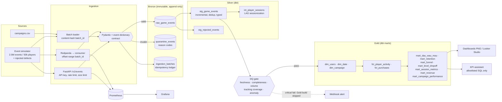

# Architecture

> All data is **simulated** (seeded Python generator). Nothing here is real company or player data.



## Layers
| Layer | Contents | Guarantees |
|---|---|---|
| Bronze | Events that passed the structural contract, plus quarantined payloads with reason codes | Never mutated; every row has `batch_id`, `source_file`, `ingested_at` |
| Silver | Typed, deduplicated events; rejected-event view; sessions | `event_id` unique; no future timestamps; purchases always have an amount |
| Gold | Star-schema dims/facts and KPI marts | Built only if the DQ gate has no critical failure |

## Lineage (dbt)
```
bronze.raw_game_events ─▶ stg_game_events ─▶ int_player_sessions ─▶ mart_session_metrics
                                   │
                                   ├─▶ dim_users ─┬─▶ mart_retention
                                   │              ├─▶ mart_funnel
                                   │              └─▶ mart_campaign_performance ◀─ dim_campaign ◀─ stg_campaigns ◀─ bronze.raw_campaigns
                                   ├─▶ fct_player_activity ─▶ mart_dau_wau_mau, mart_revenue, mart_retention
                                   ├─▶ mart_level_dropoff · fct_purchases · dim_date · mart_dq_event_volume
bronze.raw_game_events + bronze.quarantine_events ─▶ stg_rejected_events
```
`dbt docs generate && dbt docs serve --project-dir dbt --profiles-dir dbt` renders the interactive lineage graph.

## Idempotency
* **Batch level:** `batch_id` is a content hash (API/batch loader) or `topic_partition_firstOffset_lastOffset` (consumer). A batch is recorded in `ingestion_batches` in the same transaction as its rows; re-ingesting is a no-op.
* **Event level:** Silver deduplicates on `event_id` (`ROW_NUMBER`) and the incremental model upserts (`delete+insert` on DuckDB, `merge` on BigQuery), so late duplicates never double-count.
* **Delivery:** Kafka offsets are committed *after* the Bronze write (at-least-once) — replays are absorbed by the ledger.

## Storage backends
| | Local (default, free) | Cloud |
|---|---|---|
| Warehouse | DuckDB + `dbt-duckdb` | BigQuery + `dbt-bigquery` (same models; dialect differences isolated in `dbt/macros/gp_macros.sql`; BigQuery partition by `event_date`, cluster by `user_id, event_name`) |
| Ingestion store | `ingestion/store.py` | `storage/bigquery.py` (batch load jobs only — works without streaming inserts/billing) |

## Design decisions & trade-offs
* **DuckDB locally, BigQuery for cloud:** zero cost and a fast test loop; the same dbt models target both.
* **Reject at the door *and* in Silver:** structural errors (unknown event, missing required field) are quarantined at ingestion; time-dependent/cross-row errors (future timestamp, duplicates) need Silver context.
* **No Great Expectations/Soda:** dbt tests + a ~100-line DQ module cover the same rules with less to maintain.
* **Rule-based assistant instead of an LLM:** no cost, no prompt-injection surface; an LLM could later act only as a router over the same allowlist.
